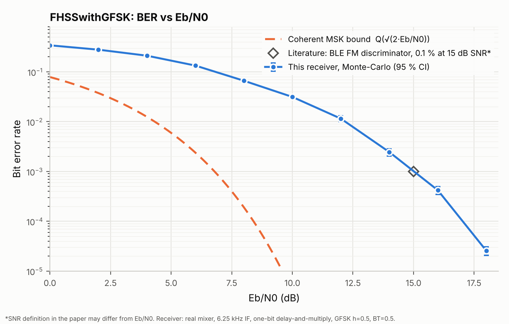

# FHSS-based-communication-System

We aim to design and an FHSS based communication system with high hops per second andd implement it on Adalm Pluto SDR.
So far we have made successful simulations of FHSS systems on Simulink and are close to implementing them on SDR.
We are using a bluetooth inspired approach as well as some hybrid methods to achieve high hops per sec.

built and tested entirely in Simulink. I used MATLAB to make graphs and analyse them, we plan to use MATLAB to directly make models as well once we are more comfortable in MATLAB than in simulink.

It is an old project that I did back in summer vacations, I didnt write the README back then so here we are.
And ever since vacations ended, I havent had enough time to continue with SDR implementation, afterall one has to go to lab for that which is tedious in itself. Kian helped me out with GFSK(It was relatively difficult setting up GFSK in simulink than it was BPSK but BER dropped significantly) and we used to do some progress weekly for first 2 weeks but got busy with other projects and coursework afterwards. I can only imagine how Sir would react. I still study the model once a week and plan to do some implementation these winters.

---

## The idea in plain words

In a normal radio link, you pick one carrier frequency and stay on it. That is easy to find, easy to jam, and easy to listen in on. In FHSS, the transmitter and receiver both jump between many frequencies in a pseudo-random order that only the two of them know. Anyone who does not know the pattern sees short bursts of energy all over the band.

Two numbers matter most:

- **Number of channels**: more channels means more places to hide.
- **Hop rate**: faster hopping means less time for anyone to find the active channel before it moves.

The receiver has to hop in lockstep with the transmitter, so every model here uses the same hop-pattern generator on both sides (idealised, with no synchronisation problem modelled).

---

## What's in the repo

| File | What it is |
|---|---|
| `FHSSwithGFSK.slx` | The main model: a Bluetooth-LE-style GFSK link with 37 hopping channels and a full non-coherent receiver. This is the most developed piece of the project. |
| `FHSSwithGFSK_verify_ber.m` | MATLAB script that sweeps Eb/N0 on the GFSK model and checks the measured BER against references. |
| `ber_reference.csv` | Reference BER numbers for the GFSK receiver (Monte-Carlo, with confidence intervals and the coherent-MSK bound). |
| `image.png` | The plot of those numbers: BER vs Eb/N0. |
| `Finally_BPSK_Passband.slx` | Baseline: a single-carrier passband BPSK link, with no hopping. |
| `BPSK_Passband_Multi.slx` | First hopping experiment: BPSK hopping between 4 fixed carriers. |
| `passband_72_channels_1.slx` | BPSK with a 72-channel NCO-based hop generator. |
| `passband_72_channels_1Updated.slx` | Follow-up to the above: DQPSK instead of BPSK, plus an interferer injected into the channel. |

### `FHSSwithGFSK.slx`: the main model

This was a **time-scaled Bluetooth LE** design. BLE hops over 37 data channels spaced 2 MHz apart; we scaled MHz down to kHz so the simulation could run at a friendly 200 kHz sample rate.

- **Data**: random bits at 1 kbps (a scaled stand-in for BLE's 1 Mbps).
- **Modulation**: NRZ bits go through a Gaussian filter and then frequency-modulate the carrier (GFSK, h = 0.5, BT = 0.5, the same parameters BLE uses).
- **Hopping**: a random integer source picks one of 37 channels (seed 777) every 8 ms, i.e. 8 bits per hop, or **125 hops/s**. A `frequency_mapper` block turns the hop index into an NCO phase increment: channels sit 2 kHz apart starting at 10 kHz.
- **Transmitter**: the GFSK frequency deviation is added directly to the hop increment of a 32-bit NCO, so modulation and hopping happen in one oscillator.
- **Channel**: AWGN, with the noise level set by Eb/N0.
- **Receiver**: a second NCO follows the same hop pattern, offset by an intermediate frequency (IF) of 6.25 kHz, and a real mixer brings the signal down to IF. After three IF filter stages, a one-bit delay-and-multiply **FM discriminator** recovers the frequency swings, followed by low-pass filters, a sampler, and a slicer. There is no carrier recovery, so detection is non-coherent.
- **Alignment**: a `Tx Delay` of 4 bits and a `Sampling Delay` of 95 samples line the receiver output up with the transmitted bits so BER can be counted.

### `FHSSwithGFSK_verify_ber.m`

This script is the model's test harness. For each Eb/N0 point it:

1. runs the simulation for a set number of bits,
2. counts errors itself from the logged `txbit` and `rxbit` signals (rather than trusting the Compute BER block),
3. gives a 95% binomial confidence interval, and
4. prints PASS or FAIL against two checks: the result must not beat the coherent MSK bound, and it must agree with the Monte-Carlo reference within about 2 sigma.

Usage: `FHSSwithGFSK_verify_ber` for the full 0 to 14 dB sweep, or `FHSSwithGFSK_verify_ber('Quick',true)` for a fast 3-point run.

Heads up: the script expects the model to have been built and calibrated by a helper called `FHSSwithGFSK_build`, and mentions an alternative model `FHSSwithGFSK_BLEhop`. Neither of those is included in this repo, so the script will not run end to end without them.

### `ber_reference.csv` and `image.png`

The reference curve comes from a separate Monte-Carlo run of the same receiver chain (200 kHz sample-based, between 1e5 and 4e6 bits per point). Columns are Eb/N0 (dB), BER, error count, bit count, 95% CI half-width, and the coherent MSK bound.

| Eb/N0 (dB) | BER |
|---|---|
| 0 | 3.4e-1 |
| 4 | 2.1e-1 |
| 8 | 6.6e-2 |
| 10 | 3.1e-2 |
| 12 | 1.2e-2 |
| 14 | 2.5e-3 |
| 16 | 4.2e-4 |
| 18 | 2.6e-5 |

The receiver sits several dB to the right of the ideal coherent bound. That is expected for a simple discriminator receiver: it is cheap and needs no phase tracking, but it pays for that in noise performance. It also lines up with a literature figure for BLE FM-discriminator receivers (about 0.1% BER near 15 dB SNR; the paper's SNR definition may differ slightly from Eb/N0).

### `Finally_BPSK_Passband.slx`: the baseline

A plain single-carrier passband BPSK link, used as a reference before any hopping was added: random bits, BPSK modulator, square-root raised-cosine transmit filter (roll-off 0.2, span 8 symbols, 8 samples per symbol), mixed up to a carrier, AWGN with a variable SNR, mixed back down, receive filter, demodulator, and a BER counter. It looks derived from MathWorks' passband modulation example.

### `BPSK_Passband_Multi.slx`: 4-carrier hopping

The same BPSK chain, but the carrier now comes from a multiport switch choosing between four oscillators at **100, 200, 300 and 400 kHz**. A repeating staircase drives the switch through the pattern **3, 1, 4, 2**, dwelling 10 ms on each. The same switch output feeds both transmit and receive mixers, so the two ends hop perfectly in sync. A Simscape voltage-controlled oscillator is sitting on the canvas but is not wired in, which looks like a leftover experiment. The run is set to only 20 ms, so you see just a couple of hops.

### `passband_72_channels_1.slx`: 72 channels from one NCO

Instead of banks of oscillators, this version uses a single **NCO** whose phase increment is changed by a hop generator, which scales far better than 4 separate sources. A random integer source picks a hop index every 1 ms (**1000 hops/s**), a MATLAB function maps it to a frequency (`f = 1 kHz + h x 1 kHz`, so channels are 1 kHz apart), and that becomes a phase increment for a 16-bit accumulator assuming a 200 kHz sample rate. Everything else is the BPSK chain from above, with AWGN at 7 dB SNR.

One thing worth double-checking if you ever revisit it: the comments describe hop indices 0 to 71 (72 channels), but the random integer block is set to a size of 71, which gives values 0 to 70. The top channel is never used.

### `passband_72_channels_1Updated.slx`: DQPSK and an interferer

Same 72-channel NCO hopper, but with a few changes:

- **DQPSK** (pi/4, Gray coded) replaces BPSK, sending 2 bits per symbol via a buffer and bit-to-integer converter.
- A **PRBS signal generator** is added to the signal on its way to the receiver, acting as a wideband interferer. A pulse generator gates it on and off. This replaces the plain AWGN block from the previous version.
- The data path looks stubbed out for debugging: both constants feeding the data switch are 0, so the transmitted data is effectively fixed.
- The solver step was tightened to 1e-7 s.

---

## Why FHSS and not just OFDM?

This was our reasoning while choosing a direction. It is informal, not a rigorous security analysis.

Security comes down to how easy the hop pattern is to predict. If an eavesdropper has enough time to watch the active channel, they could pick up the pattern after something like a thousand hops. But if the hops are too fast to even observe, they never learn which channel is active, or its frequency, and without that there is nothing to build a pattern from. That is the argument for a high hop rate (say 1200 hops/s) over, for example, 3 channels at 400 hops/s.

With OFDM, if the hopping is not fast enough, you could learn the pattern for one channel, then the next, then the next. After that, the only remaining challenge is recombining the intercepted data.

So, roughly: **FHSS is more secure, OFDM is faster.** A hybrid would get both benefits, but the design difficulty would combine too.

---

## Where it ended up

- Working Simulink simulations of FHSS at several complexity levels, from 4 carriers up to 72 channels, with a BLE-style GFSK receiver verified against a Monte-Carlo reference.
- Not done: the actual ADALM-PLUTO implementation. A likely hurdle is that SDR retuning latency limits how fast you can hop from the host side, so reaching a high hop rate probably needs hardware-timed hopping rather than host-driven retuning. We never got far enough to confirm this.

## Running the models

Open any `.slx` file in MATLAB/Simulink. The communications blocks come from the Communications Toolbox and DSP System Toolbox, `BPSK_Passband_Multi` also references Simscape, and the PRBS interferer in the Updated model needs Simulink Control Design. `FHSSwithGFSK` reads a few parameters (`KFM`, `INC_IF`) from its model workspace, which is saved inside the model file.
